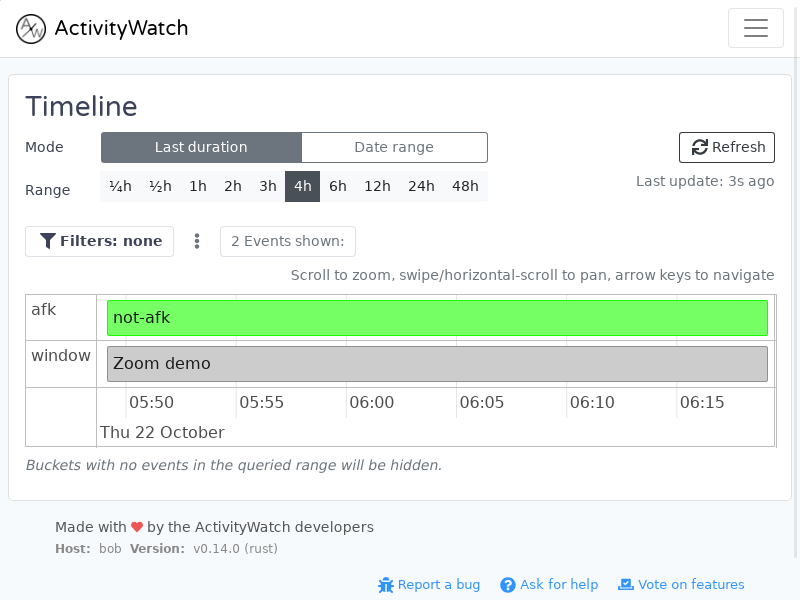
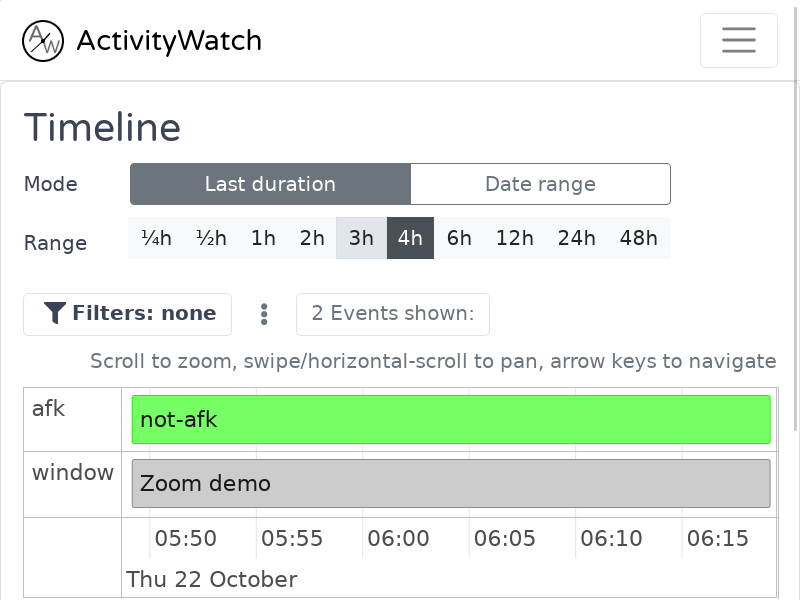

# Dashboard zoom controls

The dashboard supports Ctrl+plus (or Ctrl+equals), Ctrl+minus and Ctrl+0 to
zoom in, zoom out and reset. Ctrl+mousewheel adjusts zoom too. On macOS,
keyboard shortcuts use Command instead of Ctrl.

This uses Tauri's built-in WebView zoom. The localhost dashboard gets only
the additional `core:webview:allow-set-webview-zoom` permission needed by
Tauri's Linux/macOS shortcut handler, restricted to the `main` window.

## Linux native verification — 2026-10-22

Local source build based on `44b92d458`, locked Tauri 2.11.5 and WebKitGTK,
800×600 window, synthetic window/AFK events. Xvfb and isolated XDG roots;
private network namespace with loopback; auto-update disabled. The dashboard
assets came from a local webpack build (2026-08-19), because the locked
server does not route the newer Vite build's `/assets/` URLs.

| Input | Before repair | With flag only | With flag and permission |
| --- | --- | --- | --- |
| Ctrl+equals | 800 px viewport | 800 px, IPC denied | 666 px, 120% |
| Ctrl+plus again | 800 px | IPC denied | 571 px, 140% |
| Ctrl+minus | 800 px | IPC denied | 666 px, 120% |
| Ctrl+0 | 800 px | IPC denied | 800 px, 100% |
| Ctrl+wheel up/down | unchanged | IPC denied | 120% → 100% |

Timeline rows, labels and time axis remained aligned at 100%, 120% and 140%.
The taller content scrolls vertically at 140%.

The probe temporarily reported viewport dimensions in the native window title
and bypassed `read_notify_enabled`: its second writable datastore stalled
startup against the pinned server. Neither test-only change is in the repair.
This verifies the native zoom path, not an unmodified app's startup or a
published package. Windows/macOS runtime checks remain outstanding.

Tauri's Linux polyfill currently preserves native zoom on reload but resets
its shortcut counter: after reloading at 140%, the next zoom-in becomes 120%.
Zoom persistence and this upstream reload behavior need separate follow-up;
Ctrl+0 restores the counter and zoom to 100%.
